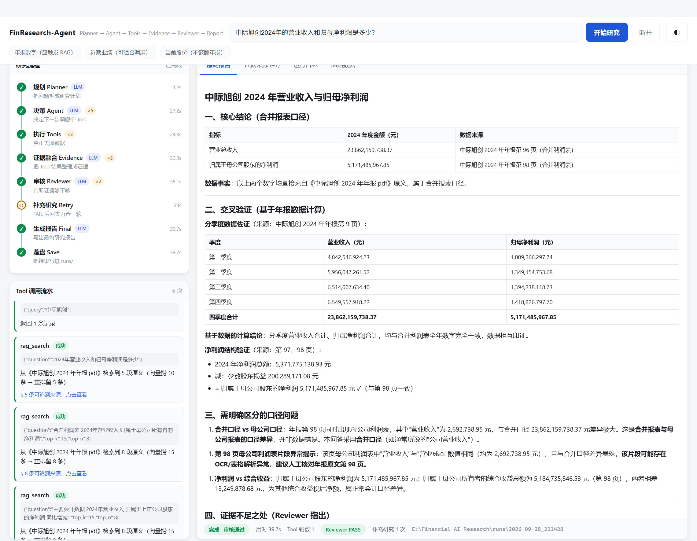
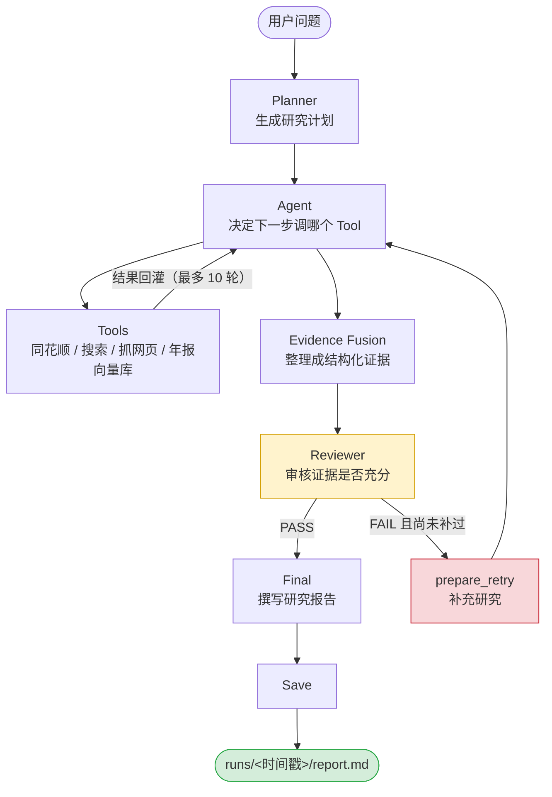

# FinResearch-Agent

> 一个**智能金融研究 Agent**：给它一个关于 A 股公司的问题，它自己规划研究步骤、自己决定调用哪些数据工具、自己审核证据够不够，最后给出一份**每个数字都能追溯回原始数据源**（年报第几页 / 哪个网址）的研究报告。




*上图为真实一次运行的界面：左边是 8 个节点的实时状态和每次 Tool 调用流水，右边是生成的研究报告。这次运行耗时 39.7 秒，中间触发过一次「证据不足 → 补充检索」的回边，Reviewer 最终判定 PASS。*

---

## 目录

- [它解决什么问题](#它解决什么问题)
- [快速开始](#快速开始)
- [架构：只有三层](#架构只有三层)
- [一次研究的完整流程](#一次研究的完整流程)
- [9 个 Tool](#9-个-tool)
- [可视化界面](#可视化界面)
- [RAG：年报检索](#rag年报检索)
- [一次真实的输出](#一次真实的输出)
- [测试](#测试)
- [已知限制](#已知限制)
- [目录结构](#目录结构)
- [代码约定](#代码约定)

---

## 它解决什么问题

问 AI「中际旭创 2024 年营收多少」，大多数情况下它会给你一个看起来很像对的数字 —— 但你没法验证它是从哪来的。财报问答里，**一个记不清的数字比一个明确的「我查不到」危险得多**。

这个项目围绕一个约束来设计：**报告里的每个数字都必须能指回它的出处**。

具体做法是：

1. **数字不靠模型记忆，只能来自 Tool 的返回**。年报原文带页码、网页带 URL，模型只负责组织和解释，不负责回忆。
2. **证据不足必须能暴露出来**。有一个独立的 Reviewer 节点专门审证据够不够，不够就回去补，而不是硬写一份完整报告。
3. **失败要明确失败**。Tool 抓不到就抛异常，绝不允许返回空值或半成品 —— 那会被当成"证据成立"污染整份报告。

这个定位来自真实使用中踩到的坑，而不是设计文档。比如测试里发现：同样是问营业收入，写成「营业收入和净利润」答案块在检索结果**第 9 名**，写成「营业收入和**归母**净利润」就掉到**第 15 名**（K=10 时进不了候选集）。这类问题只有跑起来才会暴露。

> **定位说明**：这是**学习项目**，不是企业级框架，也不是荐股或交易系统。它输出的是可核对的研究材料，不构成投资建议。

---

## 快速开始

### 环境

- **Python 3.12**（其他 3.x 大概率也可以，但没实测过）
- 需要能访问外网（同花顺数据接口、搜索引擎）
- 需要两个 Key：DeepSeek（模型）和同花顺（金融数据）

### 1. 装依赖

```bash
git clone https://github.com/Wcrane-hhy/FinResearch-Agent.git
cd FinResearch-Agent

python -m venv .venv
source .venv/bin/activate        # Windows: .venv\Scripts\activate

pip install -r requirements.txt
```

`torch` / `transformers` 体积较大，第一次装会比较慢。

> **如果报 `ModuleNotFoundError`，先怀疑解释器选错了。**
> 最典型的是 IDE 里配的解释器和你 `pip install` 的那个不是同一个。
> 本项目实测踩过这个坑：机器上装了多个 Python，PATH 里排第一的是个什么包都没有的轻量版，
> 在 IDE 里点运行就是一句光秃秃的 `ModuleNotFoundError: No module named 'langgraph'`，
> 排查方向完全被带偏。
> 现在 `main.py` 启动时会先做一次**解释器体检**，缺包会直接告诉你是哪个解释器、缺了哪几个包。

### 2. 配 Key

```bash
# Linux / macOS
export DEEPSEEK_API_KEY="你的key"
export HITHINK_FINANCE_API_KEY="你的key"

# Windows PowerShell
$env:DEEPSEEK_API_KEY = "你的key"
$env:HITHINK_FINANCE_API_KEY = "你的key"
```

缺 Key 时程序会在第一次调用时明确报错，不会静默降级。

### 3. 放年报 PDF 并建索引

仓库里**没有**PDF（是上市公司的公开文件，但不是本项目版权，且体积大），需要自己放一份：

- 到**巨潮资讯网** <http://www.cninfo.com.cn/> 搜股票代码 → 筛「年度报告」→ 下载全文 PDF
- 放进 `data/reports/`，然后：

```bash
python -m rag.rag_query --build
```

实测：**236 页 → 550 个 chunk → 550 × 512 维向量**，约 1 分钟。

> 想跳过 RAG 也能跑：其他 8 个 Tool 不依赖年报。只是年报类问题会答不上来。

### 4. 跑一次研究

```bash
python main.py                                    # 用内置的示例问题
python main.py "平安银行现在怎么样？"
python main.py --legacy "中际旭创现在怎么样"        # 走最早的手写流程版，便于对照
```

结果落在 `runs/<时间戳>/`，里面有 5 个文件：

| 文件 | 内容 |
|---|---|
| `research_plan.json` | Planner 生成的研究计划 |
| `tool_results.json` | 每次 Tool 调用的完整返回 |
| `evidence.json` | 整理后的结构化证据 |
| `review.json` | Reviewer 的审核结论和问题清单 |
| `report.md` | 最终报告 |

### 5. 打开可视化界面（可选）

```bash
python -m web_ui          # 等价于 python main.py --ui
```

浏览器会自动打开 `http://127.0.0.1:8765/`。

---

## 架构：只有三层

分清这三层，代码就全通了。

| 层 | 是什么 | 在哪 |
|---|---|---|
| **Tool = 能力** | 一段能拿到某类数据的可复用能力 | `tools/*.py` |
| **Agent = 决策** | 模型自己判断「这个问题该调哪个 Tool」 | `agent/financial_agent.py` |
| **LangGraph = 流程** | 管节点顺序、循环、失败回边 | `agent/graph_agent.py` |

### 一个关键约定：加 Tool 不用改图

**`agent/tool_registry.py` 里的 `TOOLS` 字典是 Tool 的唯一事实来源。**

新增一个 Tool 只需要在注册表里加一条，下面三处会自动生效：

- `build_tool_schemas()` → Function Calling schema（模型才知道有这个 Tool）
- `build_planner_prompt()` → Planner 看到的 Tool 清单
- `execute_tool()` → 按名字分发执行

三处都是 `for name, tool in TOOLS.items()` 的通用遍历。`search_web`、`web_fetch`、`rag_search` 三次接入都实测验证过这一点 —— **加 Tool 的标准动作是：写 `tools/xxx_tool.py` → 注册表加一行 → 写测试。不要动 `graph_agent.py`。**

---

## 一次研究的完整流程



共 **8 个节点 + 2 条条件边**。两条条件边是：

1. **Agent → Tools → Agent 的循环**：模型判断还需要数据就继续调，最多 10 轮，避免无限循环烧 token。
2. **Reviewer → prepare_retry → Agent 的回边**：证据不够就回去补一轮，补完再复审，只允许补一次。**

### 两个容易混淆的 State 字段

- `messages`：给**模型**看的对话（每次都会整段发给 DeepSeek）
- `tool_results`：给**程序**看的结构化记录（Evidence / Reviewer / Final / 落盘都读它）

**Reviewer 只读 `tool_results` 和 `evidence`，不读 `messages`。** 它审核的是证据本身，不是对话过程 —— 这是它能发现"证据来自第 98 页而不是第 8 页"这类问题的原因。

---

## 9 个 Tool

| Tool | 能力 | 数据来源 |
|---|---|---|
| `search_stock` | 按名称/代码查股票 | 同花顺 |
| `get_stock_quote` | 最新行情快照 | 同花顺 |
| `get_price_history` | 历史日 K 线 | 同花顺 |
| `get_stock_valuation` | PE / PB 等估值 | 同花顺 |
| `get_financial_statements` | 资产负债表 / 利润表 / 现金流量表 | 同花顺 |
| `calculate_financial_indicators` | 成长性 / 盈利能力 / 现金流 / 杠杆指标 | 同花顺（自己取 4 年报表）|
| `search_web` | 网络搜索（标题 + 网址 + 摘要） | 360 搜索 |
| `web_fetch` | 读某个网页的正文 | 直接抓网页 |
| `rag_search` | 检索公司年报原文（**带页码**） | 本地年报 PDF 向量库 |

---

## 可视化界面

命令行只能看到「跑完了」的结果。界面能**边跑边看它到底在想什么**。

- **左栏上**：8 个节点的实时状态 —— 谁在跑、跑了多久、循环了几次（`agent ×5` 这种直接标出来），回边 `prepare_retry` 用琥珀色区分。
- **左栏下**：每一次 Tool 调用的流水 —— 工具名、**真实传入的参数**、成功/失败、耗时、产生几条来源。
- **右栏四个页签**：最终报告（Markdown 渲染）／证据来源（年报按**第几页**列出，网页给可点开的网址）／运行日志（程序原始 stdout，Tool 报错最原始的现场在这里）／原始数据（各阶段的 JSON）。

界面上的进度**不是假动画**：它直接消费 LangGraph 的 `app.stream()`，图真正走到哪个节点，界面就亮到哪一步。

**技术上零新增依赖** —— 只用 Python 标准库的 `http.server`，推送用 SSE，前端一个外链都没有，断网也能打开。为一个本地演示界面去引入一整套 Web 框架并不划算。

### 直接链接到某次研究

界面支持用 URL 指定问题：

```
http://127.0.0.1:8765/?q=中际旭创2024年的营业收入是多少
http://127.0.0.1:8765/?q=中际旭创2024年的营业收入是多少&auto=1
```

刻意分成两个参数：**不带 `auto=1` 只预填、不自动跑**。否则别人点开你的链接就被扣一次 API 费用。

---

## RAG：年报检索

`rag/` 是一个**独立可跑**的 Pipeline，不经过 Agent 也能单独验证：

```bash
python -m rag.rag_query "中际旭创2024年的营业收入和净利润是多少？"
python -m rag.rag_query --k 20 --top-n 8 "2024年研发投入是多少？"
```

| 文件 | 做什么 |
|---|---|
| `pdf_loader.py` | PDF → **带页码**的文本（页码是后面所有溯源能力的基础）|
| `chunker.py` | 文本 → chunk（`chunk_size=500, overlap=100`）|
| `embedding.py` | text → 512 维向量（`BAAI/bge-small-zh-v1.5`）|
| `vector_store.py` | Chroma 建库 / 持久化 / 检索 |
| `rerank.py` | baseline rerank（向量 0.6 + 词面 0.4）|
| `rag_query.py` | 查询入口 `rag_query(question)` |

> **Embedding 是 HuggingFace 模型，不是 pip 包。**
> `rag/embedding.py` 里写死了离线模式（`HF_HUB_OFFLINE=1`），因为开发机器连不上 huggingface.co。
> 换机器时要么把模型下到本地缓存，要么把那两行去掉，否则 `from_pretrained` 会先联网转一圈再超时。

---

## 一次真实的输出

`runs/2026-09-28_221428/report.md`（问「中际旭创2024年的营业收入和归母净利润是多少？」）节选：

```markdown
## 一、核心结论（合并报表口径）

| 指标 | 2024 年度金额（元） | 数据来源 |
|---|---|---|
| 营业总收入 | 23,862,159,738.37 | 中际旭创 2024 年年报第 96 页（合并利润表） |
| 归属于母公司股东的净利润 | 5,171,485,967.85 | 中际旭创 2024 年年报第 98 页（合并利润表） |

## 二、交叉验证（基于年报数据计算）

**分季度数据佐证**（来源：第 9 页）：四季度营业收入合计 23,862,159,738.37，
归母净利润合计 5,171,485,967.85，与合并利润表全年数字完全一致。

**净利润结构验证**（来源：第 97、98 页）：
- 2024 年净利润总额：5,371,775,138.93 元
- 减：少数股东损益 200,289,171.08 元
- = 归属于母公司股东的净利润 5,171,485,967.85 元 ✓

## 三、需明确区分的口径问题

1. **合并口径 vs 母公司口径**：年报第 98 页同时出现母公司利润表，其中"营业收入"为
   2,692,738.95 元，与合并口径差异极大。这是口径差异，并非数据错误。
2. **第 98 页母公司利润表片段异常提示**：该页"营业收入"与"营业成本"数值相同，
   且与合并口径差异悬殊，**该片段可能存在 OCR/表格解析异常，建议人工核对原文第 98 页**。

## 四、证据不足之处（Reviewer 指出）

- **同比增减比例缺失**：未获取到同比增减比例（年报第 8 页相关行缺失），
  **当前数据不足以判断同比增速**。
```

值得注意的三点，都不是"模型写得漂亮"，而是流程本身产生的：

1. **每个数字都带页码**，可以直接翻 PDF 核对。
2. **不是单点取值，而是交叉验证**：用分季度数据加总去印证全年数字。
3. **主动报告自己的问题**：发现母公司利润表片段可能是 OCR 异常，建议人工核对；并明确说「当前数据不足以判断同比增速」，而不是编一个增速出来。

这次运行的实际调用链（Reviewer 第一轮判 FAIL，触发回边补检索后转 PASS）：

```
planner → agent → search_stock + rag_search
        → agent → rag_search ×2（模型自己把 top_k 从 10 调到 15）
        → evidence → reviewer [FAIL]
        → prepare_retry ×1  ← 回边
        → agent → rag_search ×2（top_k 进一步调到 20）
        → reviewer [PASS] → final → save     共 39.7s
```

**Agent 两次自己把 `top_k` 从 10 调到 15、20** —— Tool schema 的 description 里那句「没找到就把 top_k 调大」真的被模型用上了。

---

## 测试

全部用 `python -m tests.xxx` 跑（测试里用了相对导入）：

| 命令 | 测什么 | 断言数 | 需要网络/Key |
|---|---|---|---|
| `python -m tests.test_rag` | RAG Pipeline 全链路 | 40 | 不需要 |
| `python -m tests.test_rag_tool` | 年报检索 Tool + 注册生效 | 36 | 不需要 |
| `python -m tests.test_web_ui` | 界面翻译逻辑 + HTTP 服务 + SSE | 69 | 不需要 |
| `python -m tests.test_web_fetch` | 网页抓取 Tool + 失败路径 | 27 | 需要联网 |
| `python -m tests.test_graph_agent` | 整张图跑通 + 落盘 | 7 | 需要 Key |
| `python -m tests.test_api` | 同花顺接口（**交互式**）| — | 需要 Key |
| `python -m tests.test_agent` | 手写流程版（**交互式**）| — | 需要 Key |
| `python -m tests.test_search_tool` | 搜索 Tool（**交互式**）| — | 需要联网 |
| `python -m tests.test_stock_tool` | 股票搜索（**交互式**）| — | 需要 Key |
| `python -m tests.test_financial_tool` | 财务报表 | — | 需要 Key |
| `python -m tests.test_metric_tool` | 财务指标 | — | 需要 Key |

**前四套完全离线，172 项断言，当前全部通过**（这也意味着换了机器、没配 Key 也能验证大部分逻辑）。

标「交互式」的脚本会 `input()` 等你输入，不适合放进自动化流水线。

界面的测试之所以能离线跑，是因为它给整张图做了个假替身：不调大模型，直接喂构造好的事件，验证的是**翻译逻辑**而不是模型表现。

---

## 已知限制

写在这里的都是实测发现的真实问题，不是假谦虚。

1. **宽表 PDF 检索弱**。年报第 8 页「主要会计数据和财务指标」是标准答案页，但它是宽表，转成纯文本后变成一串数字，向量相似度很低，Top-10 捞不到。现在命中通常是第 26 页「营业收入构成」，数字相同、同样能核对，但不是最正的位置。这是「表格 PDF + 纯文本 Embedding」的结构性问题。
2. **问法影响召回**。同样问营业收入，写成「营业收入和净利润」答案块在第 9 名，写成「营业收入和归母净利润」就掉到第 15 名（K=10 进不了候选集）。补救办法是调大 `top_k`，所以 `rag_search` 保留了这个参数，让 Agent 能自己重试。
3. **Rerank 是 baseline，不是 Cross-Encoder**。它只认词形，问「营收」原文写「营业收入」时只能匹配到「营业」。
4. **只入库了一份年报**，换公司要重新放 PDF、重建索引；也不做跨文档区分。
5. **JS 渲染的网页抓不到**（腾讯新闻、东方财富股吧列表这类），没有接 Playwright 之类的无头浏览器。
6. **`search_web` 是网页抓取**，360 搜索改版就会失效 —— 这是脆弱点，不是稳定接口。
7. `final_prompt` 在 `graph_agent.py` 和 `financial_agent.py` 里各有一份（原代码里是函数内局部变量，import 不到），属于已知重复。
8. `tools/tool_definitions.py` 和 `llm/deepseek_client.py` 是历史遗留的**死代码**，主链路不 import，文件头部有标注。

---

## 目录结构

```
FinResearch-Agent/
├── main.py                    命令行入口（跑一次完整研究）
├── web_ui.py                  可视化界面的本地服务（只用标准库）
├── start_ui.bat               双击启动界面（Windows）
├── requirements.txt
├── agent/
│   ├── financial_agent.py     所有 Prompt + DeepSeek 调用 + Planner/Evidence/Reviewer
│   ├── graph_agent.py         LangGraph 图：8 个节点 + 2 条条件边
│   ├── tool_registry.py       TOOLS 注册表 ← Tool 的唯一事实来源
│   └── tool_executor.py       按名字执行 Tool
├── tools/                     9 个 Tool，一个文件一个能力
│   ├── stock_tool.py / price_tool.py / valuation_tool.py
│   ├── financial_tool.py / metric_tool.py
│   ├── search_tool.py / web_fetch_tool.py
│   └── rag_tool.py            年报检索（RAG 的 Tool 封装）
├── rag/                       独立可跑的 RAG Pipeline
├── web/
│   └── index.html             界面前端（单页，无外链 CDN）
├── tests/                     每个部分一个可独立运行的测试脚本
├── docs/
│   ├── images/                README 用的截图
│   └── 项目二-架构分析与迁移计划.md
├── data/
│   ├── reports/               年报 PDF 放这里（不进版本库，见目录内说明）
│   └── vector_db/             Chroma 落盘目录（生成物，不进版本库）
└── runs/<时间戳>/             每次运行的结果（仓库里保留了一个示例）
```

---

## 代码约定

改代码前先看这几条，它们是这个项目能在半年后还看得懂的原因。

- **加 Tool 的顺序**：写 `tools/xxx_tool.py` → 在 `tool_registry.py` 加 import 和一条注册 → 加 `tests/test_xxx_tool.py`。**不要动 `graph_agent.py`。**
- **失败要明确失败**。Tool 抓不到就抛 `RuntimeError` 并写清原因，`tools_node` 的 `try/except` 会接住并回灌给模型。**千万不要返回空字符串或半成品** —— 那会被当成"证据成立"，直接污染报告。
- **边界处理放在 Tool 内部**。项目里没有统一的截断逻辑，Tool 返回什么就原样进上下文（`json.dumps`），所以 `web_fetch` 的 `max_chars` 这类限制必须写在 Tool 自己身上。
- **数字必须可追溯**。报告里的每个数字都要能回到 `tool_results` → 具体 Tool → 数据源（文件名 + 页码 / URL）。
- **不用 class / Factory / Strategy 这类抽象包装**。Tool 就是普通函数，流程就是普通函数 + 一张图。宁可多写注释解释「为什么」，也不为了「看起来专业」加一层。

---

## 路线图

- [x] Tool + Agent + LangGraph 三层架构
- [x] 9 个金融数据 Tool
- [x] 年报 RAG（带页码溯源）
- [x] Reviewer 审核 + 失败回边
- [x] 可视化界面（标准库 + SSE，零依赖）
- [x] 4 套离线测试（172 项断言）
- [ ] **Module 2：A 股策略研究系统** —— 数据获取 / 策略实现 / 历史回测 / 参数验证 / 风险分析 / 研究报告。架构分析与迁移计划见 `docs/项目二-架构分析与迁移计划.md`
- [ ] 每日收盘后的市场复盘 Dashboard
- [ ] 评测集（当前只有单问题人工抽查，没有批量评测）

---

## 说明

- 本项目为个人学习项目，**输出内容不构成任何投资建议**。
- 数据来自公开渠道（同花顺接口、巨潮资讯网年报、公开网页），请遵守各数据源的使用条款。
- 仓库中不包含 API Key（全部从环境变量读取）、不包含年报 PDF 和向量库（均可在本地一条命令重建）。
